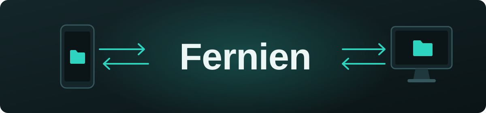
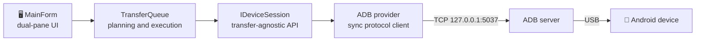

<div align="center">



### Fast, two-way file transfer between Android and Windows over a USB cable.

[](https://github.com/necipdeveci/fernien/releases/latest)


[](LICENSE)

**English** · [Türkçe](README.tr.md)

</div>

---

## 📂 About

Fernien is a dual-pane desktop file manager for moving files between an Android phone and a Windows PC. Your computer is on the left, your phone is on the right, and a single USB cable connects them.

It ships as one portable executable with the .NET runtime and ADB built in, so there is nothing to install. Under the hood it speaks the ADB protocol directly, which allows byte-level progress reporting and keeps transfers of many small files fast.

> [!NOTE]
> The application interface is currently available in Turkish.

## ✨ Features

| | |
| :--- | :--- |
| 🗂️ **Dual-pane browser** | Computer and phone side by side, with Windows icons and natural name sorting |
| 🔁 **Two-way transfer** | Send buttons, context menus or drag and drop, including from Windows Explorer |
| 📁 **Folder support** | Copies whole folders, including subfolders and empty folders |
| ⚡ **Instant detection** | The device list updates by itself when a phone is plugged in or removed |
| 📊 **Transfer queue** | Progress bar, live speed, remaining time and cancel, with partial files cleaned up |
| 🧩 **Conflict handling** | Rename (`name (1).jpg`), overwrite or skip when a file already exists |
| ✏️ **Phone file operations** | New folder, rename (F2), delete (Del) and free space display |
| 👆 **Open on double-click** | Downloads a phone file to a temporary folder and opens it in its default app |
| 🕒 **Timestamps preserved** | Modification dates are kept after transfer |

## 🚀 Getting started

1. Download `fernien.exe` from the [Releases](https://github.com/necipdeveci/fernien/releases/latest) page and run it. It works on 64-bit Windows 10 and 11.
2. On the phone, tap *Settings › About phone › Build number* seven times, then enable *Developer options › USB debugging*.
3. Connect the phone with a USB cable and accept the authorization prompt.
4. Transfer files with the send buttons or by drag and drop.

> [!TIP]
> Windows SmartScreen may warn about an unsigned executable. Choose **More info › Run anyway** to continue. Some phone brands, such as Samsung, may also need the manufacturer's USB driver.

## ⚙️ How it works



Fernien uses no external ADB package. It talks to the ADB server at the protocol level, streaming files in 64 KB chunks over a single TCP connection and reusing connections across many small files. On devices that support them, the v2 commands (`LIS2` / `STA2`) handle file sizes above 4 GB.

<details>
<summary><b>Project structure</b></summary>

```
Core/                  Transfer-agnostic interfaces
  Abstractions.cs        IDeviceProvider, IDeviceSession, DeviceInfo, RemoteEntry
  RemotePath.cs          POSIX path helpers
Providers/Adb/         USB transfer through ADB
  AdbSocket.cs           Connection to the ADB server and request framing
  AdbClient.cs           host:devices-l, features, transport, shell, track-devices
  AdbSyncService.cs      Sync protocol: STAT/STA2, LIST/LIS2, SEND, RECV
  AdbServer.cs           Locating adb.exe and starting the server
  AdbDeviceProvider.cs   Device list, live tracking, connection help texts
  AdbDeviceSession.cs    Pooled sync connections, upload/download, mkdir/rm/mv, storage info
  EmbeddedAdb.cs         Extracting the bundled ADB files
Transfer/              Queue, built only on IDeviceSession
  TransferJob.cs         Job state, progress, speed and remaining time
  TransferQueue.cs       Planning, conflict resolution, sequential execution, cancel
UI/                    Helper components: icons, sorting, input dialog
MainForm.cs            Main window
```

</details>

### Adding a new transport

Transfer methods are pluggable. To add one, such as Wi-Fi:

1. Write a class that implements `IDeviceProvider` and `IDeviceSession` (for example under `Providers/Wifi/`).
2. Register it in the `MainForm` constructor with `_providers.Add(new WifiDeviceProvider());`.

The queue, conflict handling, progress reporting and interface work with the new transport unchanged. ADB's own wireless debugging already works too: a phone paired through `adb pair` / `adb connect` appears in the list as a network device and behaves just like a cable connection.

## 🛠️ Building from source

With the [.NET 10 SDK](https://dotnet.microsoft.com/download) installed:

```bash
dotnet publish -p:PublishProfile=TekExe
```

The output is `publish\fernien.exe` (about 54 MB). In Visual Studio, right-click the project, choose **Publish** and select the **TekExe** profile.

Fernien looks for a system ADB first to avoid version conflicts, checking the application's `platform-tools` folder, `ANDROID_HOME` / `ANDROID_SDK_ROOT`, `%LOCALAPPDATA%\Android\Sdk\platform-tools` and `PATH`. If none is found, the bundled copy is extracted to `%LOCALAPPDATA%\Fernien\platform-tools\<version>\` on first run. To update the bundled ADB, replace the files in `ThirdParty\platform-tools\` and publish again.

## ⚠️ Known limitations

- Android only. iPhone needs a different protocol (AFC / libimobiledevice), which could be added as a separate provider.
- Dragging directly from the phone pane to Windows Explorer is not supported. Drag to the computer pane instead.

## 📄 License

Copyright (C) 2026 Fernien contributors

This program is free software, released under the **GNU General Public License v3**. It is distributed in the hope that it will be useful, but **without any warranty**. See [LICENSE](LICENSE) for details.

The bundled ADB files are not part of this project. They come from the Android Open Source Project under their own licenses and the Android SDK terms. See `ThirdParty/platform-tools/NOTICE.txt`, and review those terms before redistributing the executable.
