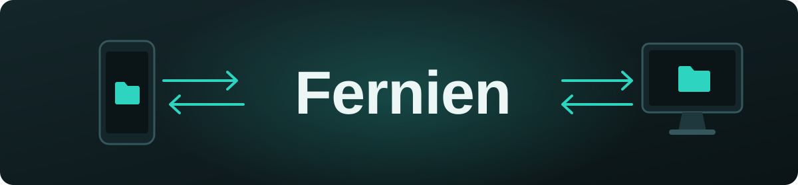
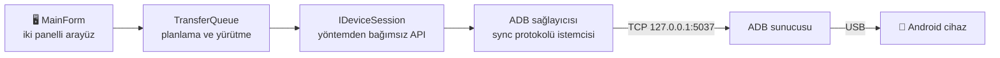

<div align="center">



### Android ile Windows arasında USB kablo üzerinden hızlı, iki yönlü dosya aktarımı.

[](https://github.com/necipdeveci/fernien/releases/latest)


[](LICENSE)

[English](README.md) · **Türkçe**

</div>

---

## 📂 Hakkında

Fernien, Android telefon ile Windows bilgisayar arasında dosya taşımak için geliştirilmiş iki panelli bir masaüstü dosya yöneticisidir. Solda bilgisayarınız, sağda telefonunuz bulunur, ikisini tek bir USB kablo bağlar.

.NET çalışma zamanı ve ADB içine gömülü, taşınabilir tek bir exe olarak gelir, yani kurulum gerektirmez. Arka planda ADB protokolüyle doğrudan konuşur; bu sayede bayt düzeyinde ilerleme gösterir ve çok sayıda küçük dosyayı hızlı aktarır.

## ✨ Özellikler

| | |
| :--- | :--- |
| 🗂️ **İki panelli gezgin** | Bilgisayar ve telefon yan yana, Windows simgeleri ve doğal ad sıralaması |
| 🔁 **İki yönlü aktarım** | Gönderme düğmeleri, sağ tık menüleri veya Windows Gezgini dahil sürükle-bırak |
| 📁 **Klasör desteği** | Alt klasörler ve boş klasörler dahil tüm klasörleri kopyalar |
| ⚡ **Anlık algılama** | Telefon takılınca veya çıkarılınca cihaz listesi kendiliğinden güncellenir |
| 📊 **Aktarım kuyruğu** | İlerleme çubuğu, anlık hız, kalan süre ve iptal, yarım kalan dosyalar temizlenir |
| 🧩 **Çakışma yönetimi** | Aynı adda dosya varsa yeniden adlandır (`ad (1).jpg`), üzerine yaz veya atla |
| ✏️ **Telefonda dosya işlemleri** | Yeni klasör, yeniden adlandırma (F2), silme (Del) ve boş alan gösterimi |
| 👆 **Çift tıkla aç** | Telefondaki dosyayı geçici klasöre indirip varsayılan uygulamasıyla açar |
| 🕒 **Tarihler korunur** | Değiştirilme tarihleri aktarımdan sonra da korunur |

## 🚀 Başlarken

1. [Sürümler](https://github.com/necipdeveci/fernien/releases/latest) sayfasından `fernien.exe` dosyasını indirip çalıştırın. 64 bit Windows 10 ve 11'de çalışır.
2. Telefonda *Ayarlar › Telefon hakkında › Yapım numarası* satırına yedi kez dokunun, ardından *Geliştirici seçenekleri › USB hata ayıklama* ayarını açın.
3. Telefonu USB kabloyla bağlayın ve çıkan izin penceresini onaylayın.
4. Dosyaları gönderme düğmeleriyle veya sürükle-bırakla aktarın.

> [!TIP]
> Windows SmartScreen imzasız exe için uyarı gösterebilir. Devam etmek için **Ek bilgi › Yine de çalıştır** seçeneğini kullanın. Samsung gibi bazı markalarda üreticinin USB sürücüsü de gerekebilir.

## ⚙️ Nasıl çalışır



Fernien harici bir ADB paketi kullanmaz. ADB sunucusuyla protokol düzeyinde konuşur, dosyaları tek bir TCP bağlantısı üzerinden 64 KB'lık parçalarla aktarır ve çok sayıda küçük dosyada bağlantıları yeniden kullanır. Destekleyen cihazlarda 4 GB üzeri dosya boyutları için v2 komutları (`LIS2` / `STA2`) kullanılır.

<details>
<summary><b>Proje yapısı</b></summary>

```
Core/                  Yöntemden bağımsız arayüzler
  Abstractions.cs        IDeviceProvider, IDeviceSession, DeviceInfo, RemoteEntry
  RemotePath.cs          POSIX yol yardımcıları
Providers/Adb/         ADB ile USB aktarımı
  AdbSocket.cs           ADB sunucusuna bağlantı ve istek çerçeveleme
  AdbClient.cs           host:devices-l, features, transport, shell, track-devices
  AdbSyncService.cs      Sync protokolü: STAT/STA2, LIST/LIS2, SEND, RECV
  AdbServer.cs           adb.exe bulma ve sunucuyu başlatma
  AdbDeviceProvider.cs   Cihaz listesi, anlık izleme, bağlantı yardım metinleri
  AdbDeviceSession.cs    Havuzlanmış sync bağlantıları, yükleme/indirme, mkdir/rm/mv, depolama bilgisi
  EmbeddedAdb.cs         Gömülü ADB dosyalarını çıkarma
Transfer/              Yalnızca IDeviceSession kullanan kuyruk
  TransferJob.cs         İş durumu, ilerleme, hız ve kalan süre
  TransferQueue.cs       Planlama, çakışma çözümü, sıralı yürütme, iptal
UI/                    Yardımcı bileşenler: simgeler, sıralama, giriş penceresi
MainForm.cs            Ana pencere
```

</details>

### Yeni bir aktarım yöntemi eklemek

Aktarım yöntemleri eklenebilir yapıdadır. Örneğin Wi-Fi eklemek için:

1. `IDeviceProvider` ve `IDeviceSession` arayüzlerini uygulayan bir sınıf yazın (örneğin `Providers/Wifi/` altında).
2. `MainForm` yapıcısında `_providers.Add(new WifiDeviceProvider());` satırıyla kaydedin.

Kuyruk, çakışma yönetimi, ilerleme ve arayüz yeni yöntemle değişmeden çalışır. ADB'nin kendi kablosuz hata ayıklaması da hâlihazırda kullanılabilir: `adb pair` / `adb connect` ile eşlenen bir telefon listede ağ cihazı olarak görünür ve kablo gibi davranır.

## 🛠️ Kaynak koddan derleme

[.NET 10 SDK](https://dotnet.microsoft.com/download) kuruluyken:

```bash
dotnet publish -p:PublishProfile=TekExe
```

Çıktı `publish\fernien.exe` dosyasıdır (yaklaşık 54 MB). Visual Studio'da projeye sağ tıklayıp **Yayımla** seçeneğinden **TekExe** profilini kullanabilirsiniz.

Fernien, sürüm çakışmasını önlemek için önce sistemdeki ADB'yi arar: uygulamanın `platform-tools` klasörü, `ANDROID_HOME` / `ANDROID_SDK_ROOT`, `%LOCALAPPDATA%\Android\Sdk\platform-tools` ve `PATH`. Hiçbiri bulunamazsa gömülü kopya ilk çalıştırmada `%LOCALAPPDATA%\Fernien\platform-tools\<sürüm>\` altına çıkarılır. Gömülü ADB'yi güncellemek için `ThirdParty\platform-tools\` içindeki dosyaları yenileyip yeniden yayınlayın.

## ⚠️ Bilinen sınırlamalar

- Yalnızca Android desteklenir. iPhone farklı bir protokol (AFC / libimobiledevice) gerektirir ve ayrı bir sağlayıcı olarak eklenebilir.
- Telefon panelinden doğrudan Windows Gezgini'ne sürükleme desteklenmez. Bunun yerine bilgisayar paneline sürükleyin.

## 📄 Lisans

Copyright (C) 2026 Fernien katkıda bulunanları

Bu program özgür yazılımdır ve **GNU Genel Kamu Lisansı sürüm 3** ile dağıtılır. Yararlı olması umuduyla, ancak **hiçbir garanti olmadan** sunulmaktadır. Ayrıntılar için [LICENSE](LICENSE) dosyasına bakın.

Gömülü ADB dosyaları bu projenin parçası değildir. Android Open Source Project'e aittir ve kendi lisansları ile Android SDK koşullarına tabidir. `ThirdParty/platform-tools/NOTICE.txt` dosyasına bakın ve exe'yi yeniden dağıtmadan önce bu koşulları kontrol edin.
